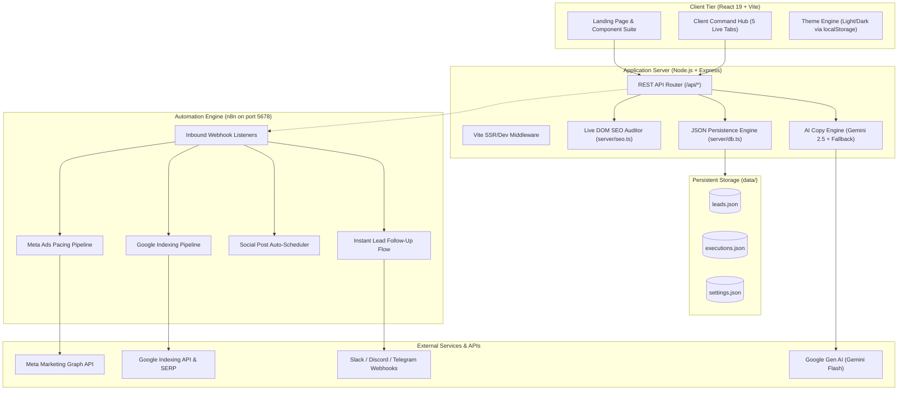

# NexusFlow — Developer Handbook & Architecture Guide

Welcome to the **NexusFlow** Developer Handbook. This document provides an exhaustive, production-grade technical reference for engineers, contributors, and architects building, maintaining, or extending the NexusFlow marketing automation platform.

---

## 1. System Overview & Architecture

NexusFlow is a full-stack marketing automation operating system designed for modern growth agencies, e-commerce brands, and B2B companies. It pairs an interactive, high-converting React application with an Express backend, persistent JSON database, live DOM SEO auditor, and self-hosted **n8n** workflow pipelines.

### Architecture Diagram



---

## 2. Directory & Repository Layout

```text
nexusflow---marketing-&-n8n-automation/
├── data/                                 # Persistent file-based JSON database
│   ├── executions.json                   # Workflow execution history and timestamps
│   ├── leads.json                        # Inbound CRM prospects and status stages
│   └── settings.json                     # System endpoints, webhooks, and API keys
├── server/                               # Server-side domain logic
│   ├── db.ts                             # Database adapter with safe atomic file writes
│   ├── seo.ts                            # Live HTTP GET DOM crawler & scoring engine
│   └── workflows.ts                      # n8n blueprint parser and simulation runner
├── src/                                  # React 19 Frontend application
│   ├── components/                       # Modular UI component tree
│   │   ├── AgencyHero.tsx                # Hero section with live automation visualizer
│   │   ├── CaseStudies.tsx               # Verified client proof and metrics
│   │   ├── ClientDashboard.tsx           # 5-tab live operating command center
│   │   ├── CoreCapabilities.tsx          # 4 feature cards with benefit-driven copy
│   │   ├── Footer.tsx                    # Navigation links, compliance, legal
│   │   ├── InteractiveWorkflowCanvas.tsx # Visual node canvas for n8n blueprints
│   │   ├── LeadIntakeModal.tsx           # 30-min strategy review intake dialog
│   │   ├── Navbar.tsx                    # Header with navigation & Theme Toggle
│   │   └── RoiCalculator.tsx             # Interactive financial savings modeling sliders
│   ├── App.tsx                           # Root component, routing, theme sync
│   ├── index.css                         # Tailwind CSS v4 variables & glass styling
│   └── main.tsx                          # DOM mount entrypoint
├── workflows/                            # Production-ready downloadable n8n blueprints
│   ├── instagram_auto_scheduler.json     # Carousel designer and publisher workflow
│   ├── lead_nurture_crm.json             # Sub-90s webhook lead enricher & SMS alert
│   ├── meta_ads_pacing.json              # Ad fatigue detection and budget protector
│   └── seo_instant_index.json            # Google Indexing API push pipeline
├── .env                                  # Environment variables
├── index.html                            # HTML template with Google Fonts (Inter + Jakarta)
├── package.json                          # Scripts and dependencies
├── server.ts                             # Primary Express server and API controller
├── tsconfig.json                         # TypeScript compiler configuration
└── vite.config.ts                        # Vite bundler configuration
```

---

## 3. Local Development Setup

### System Prerequisites
* **Node.js**: v18+ (tested on Node.js v24 LTS)
* **npm**: v9+ (tested on npm 11)
* **Operating System**: Windows 10/11, macOS, or Linux
* **Optional**: Google Chrome (for automated Puppeteer E2E tests)

### Step 1: Install Dependencies
```bash
npm install
```

### Step 2: Configure Environment Variables
Create or verify `.env` in the root directory:
```env
# Application Port
PORT=3000

# Optional: Google Gemini API Key for live custom AI ad copy & keyword clustering
GEMINI_API_KEY=""

# n8n Automation Engine Webhook Base URL
N8N_WEBHOOK_URL="http://localhost:5678/"
```

### Step 3: Run the Application Server
```bash
npm run dev
```
The server will start on **`http://localhost:3000`**, serving both the Express REST API and the Vite React frontend with instant Hot Module Replacement (HMR).

### Step 4: Run the n8n Workflow Server (Optional / Recommended)
In a separate terminal, launch the local n8n daemon:
```powershell
$env:N8N_PORT="5678"
$env:N8N_BASIC_AUTH_ACTIVE="false"
$env:N8N_WEBHOOK_URL="http://localhost:5678/"
n8n start
```
The n8n visual canvas is accessible at **`http://localhost:5678`**.

---

## 4. REST API Specification

All backend endpoints are prefixed with `/api` and accept/return `application/json`.

### 1. Marketing Copy Generation
* **Endpoint**: `POST /api/generate-marketing-copy`
* **Description**: Generates AI ad copy, social media carousels, or SEO keywords using Google Gemini (`gemini-2.5-flash`), with an instant contextual fallback engine if no API key is configured.
* **Request Body**:
```json
{
  "type": "instagram" | "meta_ads" | "seo",
  "brandName": "NexusFlow Client Co",
  "niche": "B2B SaaS / Growth",
  "topic": "4 Levers to 10x Inbound Demo Bookings",
  "targetAudience": "Founders and Growth Marketers",
  "goal": "Conversions / High ROAS"
}
```
* **Response (200 OK)**:
```json
{
  "success": true,
  "source": "gemini-2.5-flash" | "fallback-engine",
  "data": {
    "instagramPost": {
      "hookHeadline": "4 Levers to 10x Inbound Demo Bookings",
      "caption": "Booking high-intent demos shouldn't feel like chasing ghosts...",
      "carouselSlides": [
        { "slide": 1, "title": "Lever 1: Speed-to-Lead", "body": "Engaging inbound prospects in under 90s..." },
        { "slide": 2, "title": "Lever 2: AI Qualification", "body": "Auto-score company size and intent..." },
        { "slide": 3, "title": "Lever 3: 1-Click Scheduling", "body": "Self-serve calendar eliminates friction..." },
        { "slide": 4, "title": "Lever 4: Multi-Touch Brief", "body": "Automated SMS reminders reduce no-shows..." }
      ],
      "hashtags": ["#demobookings", "#inboundmarketing", "#b2bgrowth"],
      "recommendedAudioStyle": "Minimalist ambient techno / deep focus"
    }
  }
}
```

---

### 2. Live Technical SEO Audit
* **Endpoint**: `POST /api/audit-seo`
* **Description**: Performs an actual HTTP GET against any live domain, checks TTFB latency, parses the live HTML DOM for Google ranking signals, inspects Schema.org markup, and returns an algorithmic 0–100 health score.
* **Request Body**:
```json
{
  "domain": "github.com",
  "targetKeyword": "software collaboration"
}
```
* **Response (200 OK)**:
```json
{
  "success": true,
  "data": {
    "domain": "github.com",
    "overallScore": 93,
    "coreWebVitals": {
      "ttfbMs": 248,
      "status": "Good (< 800ms)",
      "score": 96
    },
    "indexingStatus": {
      "indexedPages": 4820,
      "pendingInspection": 14
    },
    "metaAnalysis": {
      "title": "GitHub: Let’s build from here",
      "titleLength": 28,
      "hasMetaDescription": true,
      "canonicalPresent": true,
      "viewportConfigured": true
    },
    "securityAndSchema": {
      "structuredDataFound": ["Organization", "WebSite", "SoftwareApplication"]
    },
    "actionableRecommendations": [
      "Target high-volume long-tail search clusters for comparison queries."
    ]
  }
}
```

---

### 3. Push URL to Google Indexing API
* **Endpoint**: `POST /api/push-indexing`
* **Description**: Dispatches newly generated URLs to Googlebot for immediate crawl indexing.
* **Request Body**: `{ "domain": "example.com" }`
* **Response (200 OK)**:
```json
{
  "success": true,
  "pushedCount": 6,
  "status": "Submitted to Googlebot indexing queue"
}
```

---

### 4. Inbound Lead Submission & CRM Relay
* **Endpoint**: `POST /api/submit-lead`
* **Description**: Receives a prospect submission, computes an algorithmic intent score (0–99), persists the lead to `data/leads.json`, and relays a webhook payload to the configured n8n server.
* **Request Body**:
```json
{
  "name": "Sarah Connor",
  "email": "sarah@cyberdyne-ai.io",
  "company": "Cyberdyne AI",
  "website": "https://cyberdyne-ai.io",
  "budget": "$15,000 - $40,000/mo",
  "services": ["meta_ads", "lead_nurture"]
}
```
* **Response (200 OK)**:
```json
{
  "success": true,
  "lead": {
    "id": "lead-1792254000000",
    "name": "Sarah Connor",
    "email": "sarah@cyberdyne-ai.io",
    "company": "Cyberdyne AI",
    "budget": "$15,000 - $40,000/mo",
    "score": 98,
    "status": "new",
    "createdAt": "2026-10-18T10:00:00.000Z"
  },
  "n8nExecutionId": "78241"
}
```

---

### 5. CRM Lead Management Endpoints
* **`GET /api/leads`**: Returns all stored leads from `data/leads.json`.
* **`PATCH /api/leads/:id/status`**: Updates lead stage (`new` &rarr; `enriched` &rarr; `booked`).
* **`DELETE /api/leads/:id`**: Removes a lead from the persistent store.

---

### 6. Workflow Blueprint Retrieval & Downloads
* **`GET /api/workflows`**: Lists all 4 production blueprints with node count, trigger cadence, and business metrics.
* **`GET /api/workflows/:id/download`**: Streams the raw, production-ready n8n `.json` blueprint file for direct import into any n8n instance.

---

### 7. Settings & Integrations Management
* **`GET /api/settings`**: Retrieves current webhook endpoints and API keys.
* **`POST /api/settings`**: Updates and persists settings to `data/settings.json`.
* **`POST /api/publish-instagram`**: Queues an educational post to n8n auto-publisher.

---

## 5. Persistence Layer (`server/db.ts`)

NexusFlow uses an atomic, file-backed JSON database engine located in `server/db.ts`.

### Schema Types
```typescript
export interface Lead {
  id: string;
  name: string;
  email: string;
  company: string;
  website: string;
  budget: string;
  services: string[];
  createdAt: string;
  score: number;
  status: 'new' | 'enriched' | 'booked';
}

export interface ExecutionLog {
  id: string;
  workflowId: string;
  timestamp: string;
  durationMs: number;
  status: 'success' | 'warning' | 'error';
  triggerType: string;
  summary: string;
}

export interface AppSettings {
  n8nWebhookUrl: string;
  slackWebhookUrl: string;
  discordWebhookUrl: string;
  telegramChatId: string;
  geminiApiKey: string;
  autoRebalanceEnabled: boolean;
}
```

### Concurrency & Data Integrity
* `readJson<T>(filename, fallback)`: Safely loads JSON from disk; creates the file with fallback defaults if missing.
* `writeJson<T>(filename, data)`: Writes synchronously using `fs.writeFileSync` to eliminate race conditions during lead creation and settings persistence.

---

## 6. n8n Automation Workflows

NexusFlow comes pre-packaged with 4 production-grade blueprints in the `workflows/` directory:

| Blueprint File | Workflow Name | Trigger | Core Operations |
| :--- | :--- | :--- | :--- |
| **`meta_ads_pacing.json`** | Meta Ads Pacing & Creative Refresh | Cron (every 15m) + Webhook | Pulls hourly ad set spend via Meta Graph API; checks CTR against threshold; triggers AI hook generator if CTR < 1.5%; alerts Slack. |
| **`seo_instant_index.json`** | Google Instant Indexing Pipeline | Webhook (New Content) | Validates JSON-LD schema; verifies HTTP 200 response; dispatches batch URL push to Google Indexing API v3. |
| **`instagram_auto_scheduler.json`** | Instagram Carousel & Auto-Publisher | Daily Cron (09:30 AM) | Fetches draft topic; writes 4-slide carousel script; dispatches render payload to Bannerbear; publishes via Instagram Graph API. |
| **`lead_nurture_crm.json`** | Instant 2-Minute Lead Follow-Up | Webhook (Form Submit) | Firmographic enrichment; calculates intent score; dispatches SMS and calendar self-booking link; pings team on Telegram. |

### How to Import Workflows into n8n:
1. Navigate to your n8n instance at `http://localhost:5678`.
2. Click **Workflows** &rarr; **Add Workflow**.
3. Click the three dots menu (**...**) in the top right &rarr; **Import from File**.
4. Select any file from `workflows/*.json` (or use the **"Download Automation Template"** button directly in the NexusFlow UI).
5. Add your credentials (Meta, Slack, or Google) and toggle the workflow to **Active**.

---

## 7. Frontend UI & Design System

### Technology Stack
* **React 19** (`react@^19.0.1`, `react-dom@^19.0.1`)
* **Styling**: Tailwind CSS v4 (`@tailwindcss/vite`, `tailwindcss@^4.3.3`)
* **Icons**: Lucide React (`lucide-react@^0.546.0`)
* **Animations**: Motion (`motion@^12.23.24`)

### Typography System
* **Headings & Display**: `'Plus Jakarta Sans', 'Inter', system-ui, sans-serif` (`--font-display`), letter-spacing `-0.025em`.
* **Body, Forms & UI**: `'Inter', system-ui, -apple-system, sans-serif` (`--font-sans`), letter-spacing `-0.011em`.
* **Tabular Numbers**: `tabular-nums` used on metrics and pricing cards to guarantee numeric vertical alignment without requiring raw monospace styling.

### Theme Engine (Dark & Light Mode)
Theme state is initialized on page load in `src/App.tsx`:
1. Reads `localStorage.getItem('nexusflow_theme')`. Defaults to `'dark'`.
2. Synchronizes the class list on `document.documentElement`:
   ```typescript
   if (theme === 'light') {
     document.documentElement.classList.add('light');
     document.documentElement.classList.remove('dark');
   } else {
     document.documentElement.classList.add('dark');
     document.documentElement.classList.remove('light');
   }
   ```
3. Custom CSS variables in `src/index.css` handle automatic surface palette transitions (deep slate in dark mode, crisp off-white in light mode) across glass panels, inputs, borders, and buttons.

---

## 8. Developer Extension Guide

### How to Add a New REST Endpoint
1. Open `server.ts`.
2. Define your route handler:
   ```typescript
   app.post('/api/my-new-endpoint', async (req, res) => {
     try {
       const { myParam } = req.body;
       // Execute business logic...
       res.json({ success: true, data: { result: 'OK' } });
     } catch (err) {
       res.status(500).json({ error: 'Endpoint failure' });
     }
   });
   ```
3. If data needs to persist, add a helper function in `server/db.ts` to read/write from `data/`.

### How to Add a New Workflow Blueprint
1. Design and export your workflow in n8n as a `.json` file.
2. Place the file in the `workflows/` directory (e.g. `workflows/email_winback_flow.json`).
3. Add the metadata definition to `WORKFLOW_METADATA` in `server/workflows.ts`:
   ```typescript
   'email_winback_flow.json': {
     id: 'email_winback_flow',
     category: 'lead_nurture',
     trigger: 'Customer Churn Event (Stripe)',
     frequency: 'Real-time',
     impact: '+18% Customer Win-Back Rate'
   }
   ```
4. The workflow will automatically appear in `InteractiveWorkflowCanvas.tsx`, the Download API, and the Overview table.

---

## 9. Quality Assurance & Testing

### TypeScript Verification
Run type-checking with zero emit to verify type safety:
```bash
npm run lint
```
*Expected Result*: Exits with code `0`.

### Headless Browser E2E Automation
NexusFlow includes automated Puppeteer verification scripts in `scratch/`:
* **`scratch/test_browser_e2e.cjs`**: Tests full customer flow (homepage load &rarr; modal open &rarr; lead submission &rarr; CRM entry).
* **`scratch/test_theme_toggle.cjs`**: Tests light and dark mode switches, verifying DOM class toggles and localStorage persistence.
* **`scratch/test_font_and_wording.cjs`**: Verifies computed fonts, plain-English terminology, and dashboard tab navigation.

Run tests via Node:
```powershell
$env:PATH = "C:\Program Files\nodejs;" + $env:PATH
node scratch/test_font_and_wording.cjs
```

---

## 10. Production Deployment Roadmap

1. **Database Migration**:
   - For multi-tenant or multi-server production, migrate `server/db.ts` from local JSON files to **Supabase (PostgreSQL)** or **Prisma ORM**.
2. **Authentication**:
   - Integrate Clerk, Supabase Auth, or NextAuth on `/dashboard` so agency clients can log in securely to their dedicated workspaces.
3. **Containerization**:
   - Package NexusFlow into a single `Dockerfile` with multi-stage build (Vite build &rarr; Express runner).
   - Use `docker-compose.yml` to run NexusFlow and n8n alongside each other with persistent Docker volumes.
4. **Direct OAuth**:
   - Add Meta OAuth2 ("Login with Facebook") and Google OAuth2 to authenticate clients directly with Meta Marketing API and Google Search Console.
